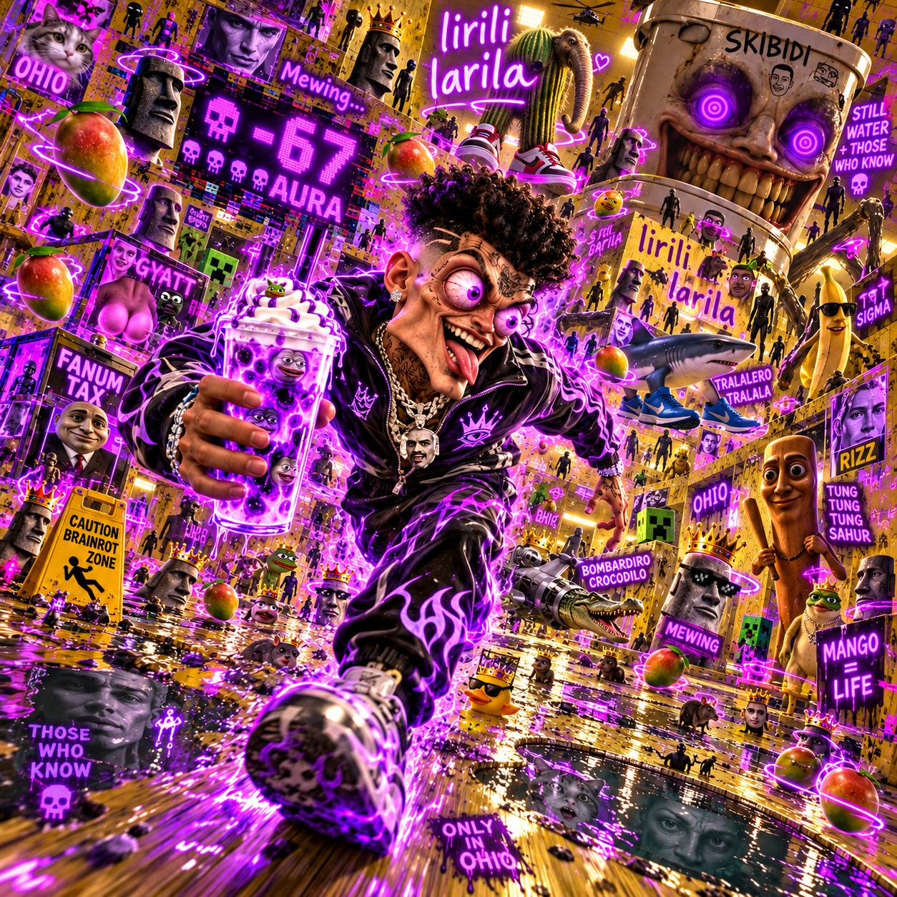

MADD GOOF AF woke up in ohio at exactly 3:33am after hearing mango phonk blasting from inside the walls, but instead of checking what was happening, bro instantly started mewing because his winter arc was already cooked and his aura balance was sitting at negative 999999. Then the skibidi rizzler final boss kicked down the door, fanum taxed his grimace shake, stole his low taper fade, and hit him with the forbidden german stare while a level 1000 gyatt goblin started aura farming in the hallway. MADD GOOF AF tried to escape through the backrooms, but every door led to more ohio, more still water, and increasingly violent Balkan rage edits playing at 200% volume. Bro activated sigma mode, whispered “those who know,” and attempted the ancient jamaican smile technique, but the ohio council immediately detected illegal levels of rizz and deployed seventeen NPCs with subway surfers gameplay under their faces. At that exact moment, mango mango mango started echoing through the ceiling and the fanum tax department confiscated his remaining 3 aura. MADD GOOF AF then unlocked forbidden mewing maxxing ultra instinct, edged the rizz singularity for six consecutive hours, and challenged the skibidi overlord to a 1v1 aura battle. Unfortunately, the overlord had premium sigma battle pass, infinite gyatt, and a 900-day mewing streak, so MADD GOOF AF got spiritually cooked, physically fanum taxed, emotionally ratioed, and teleported into the Ohio Backrooms Season 7 Battle Royale. His final words were “nah bro I’m still sigma,” right before a giant grimace shake exploded, mango phonk peaked, the Balkan rage meter reached 100%, and the entire universe lost 8 billion aura in one frame. 💀😭🙏

| |
| :-: |
|  |
|  |

Oscoooor

# Catan amb Hibernate

Fet per: Ferran Fernandez, Marc Arias i Oscar Arnabat.

## Què és aquest projecte?

És una pràctica de Java sobre el joc Catan. El programa es fa servir des de la consola i guarda les dades a MySQL amb Hibernate. Podem crear partides, fer construccions i jugar els torns des del menú.

## Què necessitem?

- JDK 21.
- Maven per carregar les dependències del projecte.
- MySQL instal·lat i en funcionament.
- Un IDE com Eclipse o IntelliJ IDEA.

## Com es prepara?

1. Obrim el projecte a l'IDE com a projecte Maven.
2. Posem el JDK 21 a la configuració del projecte.
3. Esperem que Maven carregui les dependències del fitxer `pom.xml`.
4. Obrim `src/main/resources/herHibernate.cfg.xml`.
5. Canviem l'usuari i la contrasenya pels del nostre MySQL.
6. Revisem la connexió. Per defecte, utilitza `localhost`, el port `3306` i la base de dades `catan`.
7. Executem la classe `Main.java`.

La connexió està preparada per crear la base de dades si no existeix, sempre que l'usuari tingui permisos. Hibernate utilitza `update` per crear les taules que falten i actualitzar l'estructura. No cal crear les taules a mà.

## Com es fa servir?

Quan executem el programa apareix un menú amb les opcions.

1. Triem l'opció 1 per crear una partida amb entre 2 i 4 jugadors. Escrivim els noms separats per comes.
2. El programa mostra l'ID de la partida i els ID dels elements del tauler. També els podem consultar amb l'opció 2.
3. Mirem quin jugador té el torn amb l'opció 4.
4. A la preparació, el jugador actiu col·loca un poblat amb l'opció 6 i una carretera amb l'opció 7. Després passa el torn amb l'opció 8.
5. La primera volta va en ordre i la segona va al revés. Cada jugador acaba amb dos poblats i dues carreteres.
6. Quan acaba la preparació, comencen els torns normals. El jugador tira els daus amb l'opció 9, fa les accions que pot pagar i passa el torn.
7. Si el lladre queda pendent, l'hem de moure amb l'opció 14 abans de continuar.
8. Per tancar el programa, triem l'opció 0.

Cal posar els ID que mostra el programa. El codi d'un vèrtex o d'una aresta no és el mateix que el seu ID.

## Quines opcions té?

- Crear partides i consultar el tauler i els jugadors.
- Consultar els recursos i els punts de cada jugador.
- Construir poblats i carreteres i millorar poblats a ciutats.
- Tirar els daus i repartir recursos.
- Passar el torn.
- Canviar quatre recursos d'un tipus per un d'un altre amb la banca.
- Comprar i jugar cartes de desenvolupament.
- Moure el lladre i robar un recurs quan correspon.
- Consultar l'exèrcit més gran i comprovar si hi ha un guanyador.
- Consultar els vèrtexs on el jugador pot construir un poblat en aquell moment.

## Com estan ordenats els fitxers?

- `src/main/java`: classes del joc, DAO i menú principal.
- `PartidaDao.java`: accions de les partides i càrrega del tauler.
- `JugadorDao.java`: accions dels jugadors.
- `GenericDao.java`: operacions bàsiques per guardar, consultar i eliminar dades.
- `SessionManager.java`: connexió de Hibernate.
- `src/main/resources/herHibernate.cfg.xml`: configuració de MySQL i Hibernate.
- `src/main/resources/data`: fitxers CSV amb els hexàgons, els vèrtexs, les arestes i les seves relacions.
- `pom.xml`: dependències i versió de Java.

## Si no arrenca

Comprovem que MySQL està en funcionament, que l'usuari i la contrasenya són correctes, que el projecte utilitza el JDK 21 i que Maven ha carregat les dependències.
